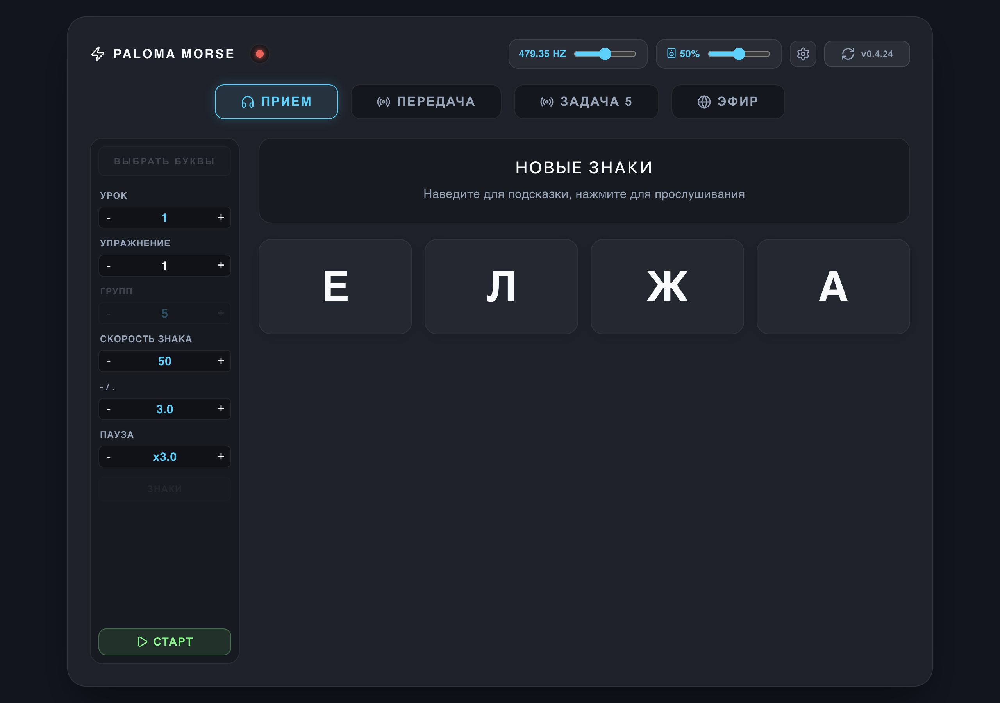
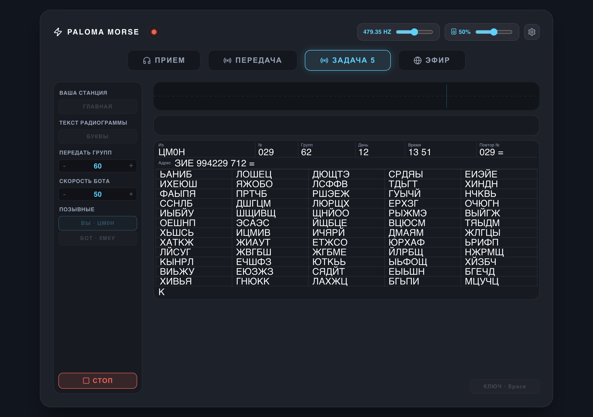

# Paloma Morse

Тренажёр азбуки Морзе для компьютера. Учитесь принимать на слух, передавать ключом и обмениваться радиограммами.

## Скачать и установить

**Выберите свою систему. Собирать программу и устанавливать движок отдельно не нужно.**

| Ваш компьютер | Что скачать |
| --- | --- |
| **Windows · 64 бит** | [Скачать для Windows (.exe)](https://github.com/sk1bid/Paloma-Morze/releases/latest#download-windows) |
| **Linux · Intel / AMD, 64 бит** | [Скачать для Linux (.AppImage)](https://github.com/sk1bid/Paloma-Morze/releases/latest#download-linux) |
| **Mac · macOS 26 и новее** | [Скачать для Mac (.dmg)](https://github.com/sk1bid/Paloma-Morze/releases/latest#download-macos) |

- **Windows:** откройте файл и следуйте шагам установщика.
- **Linux:** в свойствах файла разрешите запуск как программы, затем откройте его.
- **Mac:** откройте образ и перетащите приложение в «Программы». Подходит для Apple Silicon и Intel.

Ссылки ведут к разделу скачивания последней версии. Там нажмите ссылку своей системы; остальные файлы в списке Assets скачивать не нужно.

<details>
<summary>Уже пользуетесь Electron-версией на Mac?</summary>

[Скачать Electron для Mac](https://github.com/sk1bid/Paloma-Morze/releases/latest#download-macos-electron). Этот вариант имеет тот же интерфейс, что Windows и Linux. Текущая сборка предназначена для Apple Silicon и требует macOS 26 или новее. Для первой установки на Mac выбирайте нативное приложение выше.

Для macOS ниже 26 совместимость текущих сборок не заявлена.

</details>

<details>
<summary>Linux: требования и запуск через терминал</summary>

Нужны графическая среда, звук и 64-битный процессор Intel или AMD. Минимальная база библиотек: glibc 2.28 и GLIBCXX 3.4.25. Запуск приложения и вывод звука проверяются в CI на Debian 10.

Сборка рассчитана в том числе на старые библиотеки Astra Linux 1.7. На реальных установках Astra 1.7 и 1.8 проверка ещё требуется.

В папке со скачанным файлом:

```bash
chmod +x Paloma-Morse.*.AppImage
./Paloma-Morse.*.AppImage
```

Если система сообщает об отсутствии FUSE, можно запустить без него:

```bash
./Paloma-Morse.*.AppImage --appimage-extract-and-run
```

[Подробности проверки совместимости](tools/linux-compat/README.md).

</details>

## Как выглядит

**Приём.** Уроки, упражнения и настройка скорости.



**Задача №5.** Обмен с ботом и радиограмма для передачи. На скриншоте показан учебный вариант.



Показана Electron-версия. Нативное приложение для macOS использует системное оформление Apple.

## Что можно тренировать

- **Приём:** буквы и цифры на слух, уроки и контрольные.
- **Передача:** работа телеграфным ключом или клавишей пробела с отображением точек и тире.
- **Эфир:** связь с другими пользователями через интернет.
- **Задача №5:** обмен с ботом, паролирование, передача и приём радиограмм по 30 или 60 групп.

Для начала достаточно компьютера со звуком. USB-ключ с совместимой прошивкой PALOMA можно подключить позже. Приём, передача и задача №5 доступны без интернета; интернет нужен для эфира и обновлений.

## Обновления и помощь

Приложение поддерживает автообновление. Для ручной установки всегда используйте [последний релиз](https://github.com/sk1bid/Paloma-Morze/releases/latest).

Если что-то не работает, [напишите об ошибке](https://github.com/sk1bid/Paloma-Morze/issues/new). Укажите систему, версию Paloma Morse и что произошло; по возможности приложите скриншот.

<details>
<summary>Для разработчиков</summary>

Десктопные клиенты: React / Electron и нативный SwiftUI для macOS. Звуковой движок написан на C++. Сборки и проверки выполняет GitHub Actions.

- [Нативный macOS и CI/CD](docs/NATIVE-CICD.txt)
- [Linux: сборка на старой базе библиотек](tools/linux-compat/README.md)
- [Аудиодвижок и APAK](docs/APAK-AUDIO.txt)
- [Проверки CI](https://github.com/sk1bid/Paloma-Morze/actions/workflows/ci.yml)

</details>
